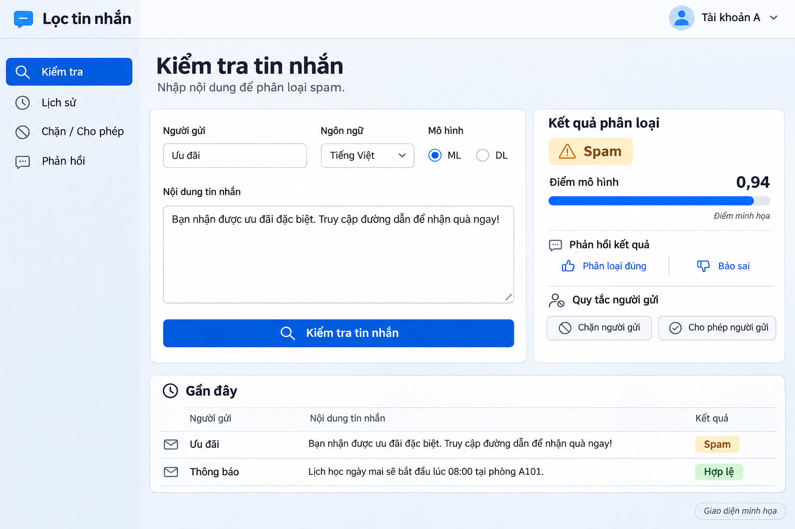
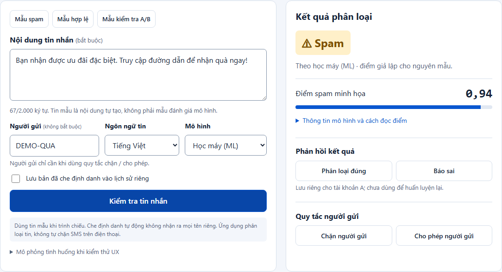

# TV4: UX, PACT và quy trình thiết kế

Đối tượng đã chốt: chỉ phục vụ demo và giảng viên.

## 1. Giữ phong cách 1, hoàn thiện trải nghiệm

Đề tài 18 · TV4 · Bộ thiết kế UX v1 · 05/11/2026

Đối tượng đã chốt: giảng viên xem demo và thành viên trình bày. Mục tiêu là giúp người xem hiểu kết quả, kiểm chứng các chức năng và theo dõi demo ngắn; chỉ thiết kế cho máy tính, không có bản mobile.

Ảnh trên là concept AI được chọn. Chỉ đánh giá những gì nhìn thấy; ảnh không chứng minh thao tác, accessibility hay API đã hoạt động.

### Kết luận về UX mẫu ban đầu

- Giữ: bố cục nhập bên trái, kết quả bên phải; một nút kiểm tra chính; nhãn chữ Spam/Hợp lệ; tài khoản luôn nhìn thấy.

- Sửa trước: giải thích điểm số, phân biệt mô hình với quy tắc, bổ sung trạng thái rỗng/chờ/lỗi và cách khôi phục.

- Phục vụ bảo vệ: ba tin mẫu, nhãn ML/DL dễ hiểu, thông tin phiên bản và kịch bản chứng minh A/B độc lập.

### Sản phẩm trong gói

Phân tích P.A.C.T; giả thuyết và kế hoạch nghiên cứu; yêu cầu; hành trình; sơ đồ luồng; wireframe; UI bấm thử; tiêu chí tiếp cận; kịch bản usability test; kết quả kiểm tra nguyên mẫu và hướng dẫn bàn giao.

Đã làm: phân tích và nguyên mẫu + kiểm tra tự động. Chưa làm: phỏng vấn người thật, đo usability thật, API/cloud và xác thực thật. Không ghi nhận các bước này là đã hoàn tất.

## 2. P.A.C.T: từ bối cảnh đến quyết định

P.A.C.T xem xét People, Activities, Contexts, Technologies và quan hệ giữa chúng [1]. Các dòng sau là phân tích áp dụng cho đề tài, dựa vào phạm vi và đối tượng người dùng đã chốt.

| Nhóm / ID | Phân tích cho demo | Quyết định UX và cách kiểm chứng |
|---|---|---|
| P1 · People | Giảng viên cần hiểu hệ thống trong ít phút; có thể hiểu ML nhưng chưa biết giao diện. | Viết “Học máy (ML)”, “Học sâu (DL)”; thông tin phiên bản/ngưỡng mở được. Kiểm tra T2/T3 với người thật. |
| P2 · People | Người thuyết trình thao tác dưới áp lực, dễ chọn nhầm tài khoản hoặc tin. | Tài khoản luôn hiện; có tin mẫu; đổi tài khoản xóa bản nháp/kết quả cũ. Kiểm tra T4 và hồi quy C09. |
| A1 · Activities | Chọn tin → chọn mô hình → kiểm tra → giải thích kết quả. Tần suất thấp nhưng cần lặp lại nhanh. | Một CTA chính, cùng nội dung khi đổi ML/DL; đổi đầu vào làm kết quả cũ hết hiệu lực. T1/T2, C08/C12. |
| A2 · Activities | Chứng minh quy tắc cá nhân và báo sai mà không sửa dữ liệu huấn luyện. | Nêu nguồn quyết định; báo sai phải chọn nhãn; quy tắc một người gửi chỉ có một trạng thái. T3/T4, C04-C06. |
| C1 · Contexts | Trình chiếu laptop, khán giả ngồi xa; phiên demo ngắn. Giả định 5-7 phút cần xác nhận. | CTA thấy ở 1366×768; chữ rõ, đủ tương phản; không dựa riêng vào màu. C13 và test trên máy chiếu thật. |
| C2 · Contexts | Mạng phòng học có thể chậm, nhiều người xem màn hình. | Chờ/lỗi/thử lại giữ bản nháp; chỉ dùng tin tự tạo; bật lưu lịch sử khi cần minh chứng. T5, C07. |
| T1 · Technologies | Ứng dụng web cloud dùng model Việt/UCI riêng, trả label, score, threshold và version. | Chọn ngôn ngữ minh bạch; không suy diễn 0,94 là đúng 94%; điểm mô hình không áp cho quyết định do quy tắc. C02/C04. |
| T2 · Technologies | Nhiều tài khoản và nhiều máy phải dùng chung dịch vụ nhưng dữ liệu tách biệt. | Giao diện có A/B; bản thật cần phiên đăng nhập và lọc owner ở server. Chứng minh bằng hai trình duyệt/API, không bằng dropdown nguyên mẫu. |

T1-T5 là tác vụ nghiên cứu ở trang 9. C01-C14 là kiểm tra nguyên mẫu; đối chiếu trang 10. Đây là phân tích định tính, không chấm điểm PACT tùy ý.

## 3. Nghiên cứu: biết gì, cần kiểm chứng gì?

### Căn cứ hiện có

- Đã xác nhận: người dùng chọn phong cách 1; ưu tiên demo và giảng viên; TV4 phải có API, tài khoản, quy tắc riêng và phản hồi. Model và bộ nạp TV2/TV3 đã có.

- Chưa có bằng chứng: thời lượng demo thực tế; mức hiểu điểm số; cách giảng viên tìm tính năng; trải nghiệm trên máy chiếu. Persona dưới đây là giả thuyết, chưa phải dữ liệu phỏng vấn.

| Proto-persona | Công việc cần hoàn thành | Vướng mắc dự kiến |
|---|---|---|
| Giảng viên đánh giá | Hiểu mô hình đang dùng, căn cứ của kết quả và sự tách biệt tài khoản. | Không có thời gian tự khám phá; dễ nhầm phân loại với chặn SMS thật. |
| Thành viên thuyết trình | Tái hiện demo, xử lý lỗi nhanh, giải thích kết quả đúng phạm vi. | Chọn nhầm model/tài khoản; kết quả cũ còn hiện sau khi đổi đầu vào. |

### Kế hoạch khám phá trước thử nghiệm

Mời 1-2 giảng viên/trợ giảng và 3 sinh viên chưa dùng giao diện; đây là mẫu thuận tiện nhỏ để tìm vấn đề, không đại diện toàn bộ người dùng. Phỏng vấn 10 phút/người rồi làm tác vụ 15-20 phút. Xin phép ghi chú/ghi hình; chỉ dùng tin mẫu.

| Câu hỏi trung lập | Giả thuyết cần kiểm chứng |
|---|---|
| Khi xem một demo lọc spam, bạn cần thấy gì để tin rằng chức năng hoạt động? | Cần nguồn quyết định và minh chứng A/B hơn số lượng biểu đồ. |
| Bạn hiểu “điểm 0,94” và “ngưỡng” như thế nào? | Điểm số cần chú giải; không trình bày như độ chắc chắn. |
| Hãy kể cách bạn kiểm tra hai tài khoản không ảnh hưởng nhau. | Cần luồng chuyển phiên rõ và dùng cùng tin để đối chiếu. |
| Nếu dịch vụ lỗi giữa buổi demo, bạn sẽ làm gì? | Giữ bản nháp và thử lại giúp tiếp tục mà không lặp thao tác. |

### Điều kiện thay đổi thiết kế

Nếu người xem không giải thích đúng nguồn quyết định, sửa câu chữ trước khi thêm biểu đồ. Nếu CTA bị khuất trên máy chiếu, giảm chiều cao form. Nếu mọi người không tìm được luật cá nhân, đổi nhãn điều hướng và thử lại. Ghi kết quả thật vào biểu mẫu, không điền số liệu giả.

## 4. Đánh giá mẫu 1 và yêu cầu ưu tiên

Đánh giá ảnh concept theo ba checklist: Submitting a form, Showing input error, Loading [3-5]. Bảng audit đầy đủ từng mục, đúng thứ tự và mô tả gốc, nằm trong docs/AUDIT_MAU_1.md. Không xác nhận hành vi bằng ảnh tĩnh.

| Quan sát trên ảnh | Ảnh cho biết gì? | Cần xử lý |
|---|---|---|
| CTA kiểm tra dưới form | Có nút chính rõ ràng. | Giữ một hành động chính; thêm nút tin mẫu phục vụ demo. |
| Kết quả Spam + 0,94 | Có nhãn chữ, thanh điểm và chú thích minh họa. | Giải thích điểm/ngưỡng, không gọi là “độ chính xác 94%”. |
| Chặn / cho phép người gửi | Có thao tác nhưng chưa mô tả xung đột. | Người gửi tùy chọn; một quy tắc/người gửi; hỏi khi thay ngược lại. |
| Phân loại đúng / báo sai | Có hai lối phản hồi. | Báo sai mở chọn nhãn và xác nhận lưu riêng; không tự huấn luyện lại. |
| Tài khoản A | Có nhãn tài khoản. | Cần thử A/B thực; ảnh không chứng minh cách ly dữ liệu. |
| Chờ, lỗi, bàn phím, desktop | Không thể kết luận từ ảnh này. | Đặc tả và thử trên nguyên mẫu; không gọi là “thiếu implementation”. |

### Yêu cầu có thể nghiệm thu

| ID / ưu tiên | User story và điều kiện chấp nhận |
|---|---|
| R1 · Bắt buộc | Người trình bày kiểm tra một tin: nội dung bắt buộc, người gửi tùy chọn, có empty/loading/error/success; lỗi giữ bản nháp. |
| R2 · Bắt buộc | Giảng viên phân biệt ML/DL và nguồn kết luận: hiện ngôn ngữ, phiên bản, điểm/ngưỡng thật; quy tắc không giả làm đầu ra model. |
| R3 · Bắt buộc | A/B có luật, lịch sử, phản hồi riêng; đổi phiên xóa dữ liệu tạm; máy chủ kiểm soát quyền sở hữu mọi thao tác. |
| R4 · Bắt buộc | Báo sai có nhãn đề xuất và trạng thái đã lưu/chờ rà soát. Không thay nhãn gốc, không tự cập nhật model. |
| R5 · Nên có | Tin mẫu tự tạo; lịch sử opt-in bản che định danh; tìm/lọc kết quả; xóa cần xác nhận. |
| R6 · Nên có | Dùng bàn phím; nhìn rõ trên máy chiếu; desktop 1280-1920px không tràn toàn trang. |
| R7 · Chưa làm | Nhập SMS điện thoại tự động, chặn SMS hệ điều hành, tự retrain, dashboard vận hành lớn. |

## 5. Hành trình, cấu trúc và luồng chính

| Chặng | Việc người dùng làm | Thiết kế hỗ trợ |
|---|---|---|
| Chuẩn bị | Mở ứng dụng; chọn đúng phiên A; chọn tin tự tạo. | Tài khoản hiện rõ; kịch bản demo ngay điều hướng. |
| Kiểm tra | Chọn ngôn ngữ/model; gửi kiểm tra. | Giữ nội dung khi đổi ML/DL; báo chờ; chống gửi lặp. |
| Hiểu kết quả | Đọc nhãn; hỏi vì sao có quyết định ấy. | Nguồn model/quy tắc; điểm và ngưỡng; thông tin mở rộng. |
| Chứng minh cá nhân hóa | Chặn DEMO-A ở A rồi thử cùng tin ở B. | Kết quả do luật được ghi rõ; lịch sử/luật riêng từng tài khoản. |
| Sửa sai / kết thúc | Gửi phản hồi; xem minh chứng; đăng xuất. | Xác nhận nhãn đề xuất; chỉ lưu tin đã chọn; xóa dữ liệu tạm khi kết thúc phiên. |

### Kiến trúc thông tin

Kiểm tra (màn mặc định) · Lịch sử (lọc, xem lại, xóa) · Chặn / Cho phép (thêm, thay, gỡ) · Kịch bản demo (chỉ ở bản demo). Phản hồi gắn với một lần phân loại, không cần một màn nhập phản hồi rời.

### Luồng kiểm tra và cá nhân hóa

Sơ đồ được vẽ trong PDF; luồng bấm thử ở ../index.html.

Ưu tiên quy tắc trước model giúp minh chứng cá nhân hóa rõ ràng. Tin không có người gửi bỏ qua nhánh quy tắc. Một chủ tài khoản + người gửi chuẩn hóa chỉ có một quy tắc nên không tồn tại đồng thời chặn và cho phép.

### Hai nhánh cần giữ người dùng trong luồng

- Lỗi dịch vụ: giữ nội dung → nêu lỗi → thử lại; không hiện nhãn cũ như kết quả mới.

- Báo sai: từ kết quả → chọn nhãn đề xuất → lưu riêng → xác nhận chờ rà soát. Hủy hoặc Escape không thay đổi dữ liệu.

## 6. Wireframe và quyết định giao diện

Giữ cấu trúc hai cột của mẫu 1, nhưng đổi thứ tự để hành động cần thiết xuất hiện trước. Đây là wireframe định hướng, không phải ảnh kiểm thử người dùng.

Sơ đồ được vẽ trong PDF; luồng bấm thử ở ../index.html.

| Quyết định | Lý do gắn với PACT |
|---|---|
| Nội dung trước; người gửi sau và tùy chọn | A1/A2: phân loại chỉ cần nội dung; người gửi dùng riêng cho quy tắc. |
| Tin mẫu trước trường nhập | P2/C1: giảm thao tác gõ trong buổi bảo vệ và tránh lộ SMS thật. |
| Tên đầy đủ + ML/DL vẫn hiện | P1: đối tượng giảng viên cần so sánh; không giấu lựa chọn sau nhiều lớp nâng cao. |
| Điểm số đặt dưới nhãn, có giải thích | T1: ưu tiên kết luận và căn cứ; không coi score là độ chính xác. |
| Đổi đầu vào làm hết hiệu lực kết quả | A1: tránh xem nhầm nhãn của tin/model trước; hủy phản hồi đang chờ nếu đầu vào đổi. |
| Chỉ desktop, giữ hai cột | C1/T2: người dùng đã chốt máy tính. Tối ưu 1280×720, 1366×768, 1440×900 và 1920×1080; không làm bản mobile. |

Màu, kiểu chữ và khoảng cách là quyết định thiết kế. Cần kiểm tra trên màn hình/máy chiếu thật trước khi chốt visual cho phiên bảo vệ.

## 7. Trạng thái tương tác và câu chữ

| Trạng thái / kích hoạt | Hiển thị / hành vi | Khôi phục hoặc bước tiếp |
|---|---|---|
| Rỗng · chưa kiểm tra | “Chưa có kết quả”; gợi ý nhập tin/chọn mẫu. Không gán Spam mặc định. | CTA hoạt động; gửi rỗng báo lỗi ở trường nội dung. |
| Sai đầu vào | “Nhập nội dung tin nhắn trước khi kiểm tra.”; aria-invalid, role=alert; focus về trường. | Sửa dữ liệu rồi kiểm tra; không báo lỗi khi vừa mở trang. |
| Đang chờ | “Đang kiểm tra tin nhắn...” + chỉ báo; khóa gửi lặp; aria-busy/status. | Đổi đầu vào hoặc tài khoản hủy kết quả chờ; không chấp nhận phản hồi cũ. |
| Thành công do mô hình | Spam/Hợp lệ; học máy/học sâu; điểm, ngưỡng và phiên bản. | Phản hồi; thêm luật khi có người gửi. Không tự chặn SMS thật. |
| Thành công do quy tắc | “Theo quy tắc chặn/cho phép của tài khoản A. Mô hình không được gọi.” | Hiện quản lý/gỡ luật; không tạo điểm mô hình giả. |
| Lỗi kết nối / timeout | “Không kết nối được dịch vụ. Nội dung bạn nhập vẫn còn.” | Có thử lại. Bản thật: timeout rõ; không tự gửi lại POST gây bản ghi trùng. |
| Kết quả hết hiệu lực | Đổi text/model/ngôn ngữ/người gửi → xóa kết quả cũ. | “Kiểm tra lại để có kết quả mới.” Giữ bản nháp cùng tài khoản. |
| Chuyển tài khoản | Xóa form, kết quả, lỗi và modal; tải lại danh sách đúng chủ. | Bản thật: phiên đăng nhập hợp lệ và kiểm tra quyền ở server. |
| Quy tắc xung đột | Hỏi xác nhận thay chặn ↔ cho phép; hiển thị người gửi, trạng thái cũ/mới. | Hủy giữ luật cũ; xác nhận cập nhật duy nhất một luật. |
| Phản hồi đã lưu | “Đã lưu phản hồi ... đang chờ rà soát, chưa thay đổi mô hình.” | Nhãn đề xuất độc lập với nhãn gốc; lưu source của kết quả. |
| Lịch sử trống / xóa | Giải thích chưa bật lưu hoặc không có kết quả lọc. Xóa có xác nhận. | Quay về kiểm tra; xóa chỉ tài khoản hiện tại. |
| Phiên hết hạn · bản thật | Đưa về đăng nhập, xóa dữ liệu riêng khỏi màn hình; thông báo cần đăng nhập lại. | Không tự chuyển sang tài khoản khác; không giữ SMS thật trong storage công khai. |

Giới hạn đề xuất ở API: 1-2.000 ký tự nội dung, người gửi tối đa 80 ký tự. UI không cắt thầm; API phải xác thực cùng giới hạn. Bản thật cần thông báo khi tokenizer cắt chuỗi theo cấu hình model.

## 8. Hi-fi và tiêu chí khả năng tiếp cận

Ảnh chụp nguyên mẫu HTML sau khi bấm thử. Kết quả 0,94 là giả lập; các file ảnh desktop đầy đủ nằm trong screens/. Nguyên mẫu chỉ trả điểm cố định cho tin mẫu, không dùng từ khóa để giả làm mô hình.

### Hệ thống thị giác

Nền #F3F6FB · bề mặt #FFFFFF · chữ #172338 · chữ phụ #53647B · nút #0957D0 · cảnh báo #805000 trên #FFF0C9. Chữ giao diện Segoe UI/Arial; số dùng Consolas. Cỡ thân 16px; tiêu đề 30px; chữ phụ 12-14px. Lưới khoảng cách 4/8/12/16/20/24px; bo góc 8/12px.

### Mục tiêu theo WCAG 2.2 [2]

- Tương phản: chữ thường ít nhất 4,5:1, chữ lớn 3:1; thành phần UI quan trọng 3:1. Không dùng màu làm dấu hiệu duy nhất.

- Thao tác: Tab theo thứ tự; focus thấy rõ, không bị che; có skip link; dialog có tên, Escape đóng và trả focus. Nút chính/input cao 44px; mọi target đáp ứng tối thiểu 24×24 CSS px hoặc ngoại lệ/khoảng cách hợp lệ.

- Phản hồi: có nhãn thật cho input; lỗi mô tả bằng chữ; trạng thái động dùng role/status phù hợp; tôn trọng reduced motion. Kiểm tra phóng to chữ và focus trên máy tính; chưa xác nhận toàn bộ yêu cầu reflow.

Đây là tiêu chí nghiệm thu, chưa tuyên bố đạt toàn bộ WCAG AA. Tương phản số, bàn phím và kích thước layout được kiểm tra trong phạm vi nguyên mẫu; screen reader và máy chiếu còn phải thử.

## 9. Usability test: kịch bản để chạy với người thật

Mục đích: kiểm chứng người xem hiểu kết quả và người trình bày thực hiện được demo. Đề xuất 5 người: 1-2 giảng viên/trợ giảng, còn lại sinh viên chưa dùng giao diện. Không dùng số mẫu này để khẳng định tỷ lệ thành công của toàn bộ người dùng.

Mỗi phiên 25-30 phút: xin phép/giới thiệu 3 phút; làm tác vụ 15-20 phút; hỏi lại 5 phút. Không hướng dẫn vị trí nút. Cho người tham gia nói suy nghĩ; ghi khi cần trợ giúp. Dùng duy nhất tin tự tạo.

| Tác vụ đưa cho người thử | Hoàn thành khi | Mục tiêu dự kiến |
|---|---|---|
| T1: Kiểm tra một tin mẫu và nói kết luận. | Tự chọn mẫu, chọn kiểm tra, đọc đúng nhãn. | ≤45 giây; không cần trợ giúp. |
| T2: Kiểm tra cùng tin bằng cách học còn lại. | Giữ đúng nội dung; đổi ML/DL; biết cần kiểm tra lại. | ≤30 giây; nêu đúng model/ngôn ngữ. |
| T3: Bạn cho rằng kết quả sai. Hãy phản hồi và giải thích số điểm. | Chọn nhãn đề xuất, lưu; hiểu chờ rà soát; không gọi 0,94 là độ chính xác. | ≤60 giây; giải thích đúng score khác accuracy. |
| T4: Chứng minh luật của A không tác động đến B. | Chặn DEMO-A ở A; cùng tin ở B; chỉ ra nguồn quyết định và lịch sử khác nhau. | ≤90 giây; biết dropdown chưa chứng minh server. |
| T5: Gặp lỗi dịch vụ khi kiểm tra. Hãy tiếp tục. | Nhận ra lỗi, thấy bản nháp còn; thử lại hoặc dừng có chủ đích. | ≤30 giây; không gõ lại tin. |

### Ghi và phân tích

Đo thời gian từ lúc đọc xong tác vụ đến khi đạt tiêu chí; ghi hoàn thành độc lập / có trợ giúp / thất bại, số lỗi quan trọng và SEQ 1-7 sau mỗi tác vụ. Câu hỏi SEQ: “Bạn thấy tác vụ này dễ hay khó?” (1 rất khó, 7 rất dễ). Ghi câu nói nguyên văn nếu có phép.

Cổng vòng 1 đề xuất: ít nhất 4/5 người hoàn thành độc lập T1/T2/T3/T5; mọi người hiểu đúng nguồn model/quy tắc sau T4; không có lỗi lộ dữ liệu hoặc nhầm hành động. Đây là mục tiêu nội bộ, chưa có kết quả đo.

Mẫu ghi trống: docs/usability_observations.csv. Tên người thử dùng mã U01-U05. Sau test: nhóm vấn đề → ưu tiên chặn luồng/hiểu sai/khó dùng → sửa → thử lại tác vụ liên quan; không tự điền PASS.

## 10. Đã kiểm tra gì và chưa chứng minh được gì?

Kiểm tra tự động bằng Playwright trên nguyên mẫu HTML, tách khỏi usability test. Kết quả chính xác theo tests/verification.json; ảnh chụp lưu trong screens/. Các bước này kiểm tra trạng thái và thao tác UI, không đo hiểu biết người thật.

Kiểm tra nguyên mẫu: 14/14 PASS; chi tiết tests/verification.json.

### Kiểm tra thị giác và khả năng tiếp cận

Đã xem ảnh desktop và dialog; kiểm tra 1280×720, 1366×768, 1440×900 và 1920×1080, điều hướng bàn phím cơ bản, CTA desktop và trạng thái dialog. Bổ sung phép đo tương phản các cặp màu thiết kế trong docs/contrast_check.json. Có reduced-motion; chưa test screen reader, trợ năng hệ điều hành hay máy chiếu thực.

### Phân biệt bằng chứng

| Có thể kết luận từ nguyên mẫu | Phải kiểm tra ở ứng dụng thật |
|---|---|
| UI cập nhật A/B và lịch sử/luật trong bộ nhớ khác nhau. | Đăng nhập thật, DB theo owner, chống truy cập ID tài khoản khác. |
| Tin mẫu trả nhãn/điểm cố định; mọi điểm được ghi là giả lập. | API nạp đúng model; đúng privacy/vectorizer/threshold/version; độ trễ thực. |
| Có nhánh lỗi, thử lại, hủy phản hồi cũ khi đổi input/account. | Timeout, nhiều request đồng thời, mất phiên, cold start và nhiều máy cloud. |
| UI đã đo layout và chạy kiểm tra tự động. | Người thật tìm đúng thao tác, hiểu kết quả, demo tốt trên máy chiếu. |

Không dùng PASS của nguyên mẫu để tuyên bố TV4 đã hoàn thành ứng dụng cloud. Không dùng điểm giả lập làm kết quả ML/DL hoặc đưa vào bảng đánh giá mô hình.

## 11. Bàn giao TV4: quy tắc và hợp đồng tích hợp

### Nguyên tắc tích hợp không sửa phần thành viên khác

Chỉ thêm cloud_app/bo_sung_tv4_ux/. Khi triển khai ứng dụng, tạo thư mục riêng cho API/UI. Tái sử dụng bộ nạp predict.py và predict_dl.py của các gói bổ sung; không sửa dữ liệu, ngưỡng, model hay code TV1-TV3 để phục vụ giao diện.

| Chức năng API đề xuất | Dữ liệu / quy tắc quan trọng |
|---|---|
| POST /api/predictions | text, sender?, language, model, save_history; xác thực server; owner lấy từ phiên, không từ body. |
| Kết quả do model | label, decision_source=model, model_label, score đầy đủ, threshold, model_version, dataset_id, language, truncated và prediction_id. UI chỉ làm tròn khi hiển thị. |
| Kết quả do luật | label + decision_source=block/allow + rule_id; score=null vì model không được gọi. Không trả score 1,0 để giả mức chắc chắn. |
| GET /api/history | Chỉ bản ghi của chủ phiên; phân trang/lọc; bản text đã che định danh; có xóa theo quyền. |
| PUT/DELETE /api/rules/{sender} | Chuẩn hóa NFC/trim/case theo quy ước; unique(owner, sender_key); cập nhật luật phải xác nhận ở UI. |
| POST /api/feedback | prediction_id, proposed_label, note?; server kiểm tra ownership; gắn nguồn model/quy tắc; trạng thái chờ rà soát. |

### Chọn đúng gói mô hình

Mặc định đề xuất: tiếng Việt + ML. ML Việt hiện là BoW Logistic Regression; DL Việt được validation chọn là LSTM; DL UCI chọn Conv1D. Dùng load_model(language) của từng gói, không chọn lại model bằng điểm test. Không tự đặt threshold=0,5 ở frontend.

### Nghiệm thu bản cloud bắt buộc

- Hai phiên đăng nhập A/B trên hai trình duyệt hoặc hai máy; A không đọc/sửa/xóa lịch sử, luật hay phản hồi của B bằng API kể cả sửa ID. Tài khoản hết hạn bị từ chối.

- Cùng tin + cùng tài khoản + cùng model cho đầu ra khớp bộ nạp; nguyên tắc luật được thực hiện và ghi nguồn; phản hồi không retrain.

- HTTPS, lưu dữ liệu theo chủ, không log SMS thô, giới hạn request/timeout, xóa dữ liệu demo trước khi giao. Những mục này chưa có trong nguyên mẫu.

## 12. Quy trình thực hiện và tài liệu tham chiếu

| Bước | Đầu ra / người thực hiện | Tình trạng |
|---|---|---|
| 1. Chốt bài toán | TV4 + người dùng: đối tượng giảng viên, demo; giữ style 1. | Đã xác nhận |
| 2. Khám phá | TV4: phỏng vấn ngắn, hỏi cách đánh giá demo, xác nhận thiết bị. | Có kế hoạch; chưa phỏng vấn |
| 3. Tổng hợp | TV4: PACT, proto-persona, journey, yêu cầu và ưu tiên. | Đã lập từ căn cứ + giả thuyết |
| 4. Cấu trúc | TV4: IA, flow, trạng thái, wireframe. | Đã lập |
| 5. Nguyên mẫu | TV4: UI sáng xanh, luồng chính + lỗi; mẫu A/B. | Đã dựng; chưa API |
| 6. Đánh giá | TV4: tự kiểm tra UI; usability test thật, sửa và test lại. | Tự kiểm tra đã chạy; user test chờ |
| 7. Triển khai | TV4: API, DB, xác thực, tích hợp model, cloud. | Chưa triển khai |
| 8. Bàn giao | TV4 giao URL/API/demo/README và minh chứng; TV5 đưa vào báo cáo. | Sau nghiệm thu ứng dụng thật |

### Kịch bản bảo vệ đề xuất · 5-7 phút

30 giây giới thiệu → 1 phút kiểm tra tin mẫu bằng ML → 1 phút đổi DL và đọc điểm/ngưỡng → 2 phút quy tắc A/B → 1 phút báo sai + lịch sử → 30 giây giới hạn và xử lý lỗi. Đây là lịch đề xuất, cần diễn tập rồi điều chỉnh.

### Nguồn tham chiếu

[1] David Benyon, Designing User Experience, 4th ed., chương 2 PACT. Pearson: thông tin sách. Khung phân tích được áp dụng cho dự án; không dùng làm thang điểm.

[2] W3C, WCAG 2.2: 1.4.1, 1.4.3, 1.4.11, 2.1.1, 2.4.7, 2.4.11, 2.5.8, 3.3.1 và 4.1.3. Là tiêu chí thiết kế/kiểm thử, chưa phải chứng nhận conformance.

[3-5] Checklist Design: Submitting a form; Showing input error; Loading. Audit dùng bản nội dung được cung cấp trong skill, không suy diễn hành vi từ ảnh.

Căn cứ nội bộ: phân công đề tài 18; README/bộ nạp TV1-TV3 trong repo local; ba concept đã tạo; lựa chọn đối tượng và mẫu 1 của người dùng. Toàn bộ hướng dẫn từ tài liệu được xem là nội dung tham khảo, không thay chỉ đạo của người dùng.
